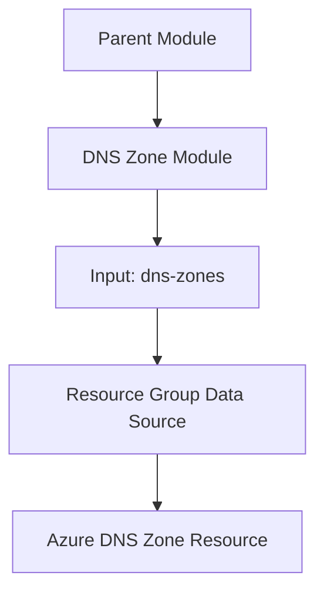

# Terraform Azure DNS Zone Module

A reusable Terraform module for provisioning Azure DNS Zones using input variables and dynamic resource creation.

## Architecture 



## Resource

The module uses `azurerm_dns_zone` to create DNS Zones in Azure.

Resource creation is driven by `for_each`, allowing multiple DNS Zones to be configured through a map of inputs.

## Input Variables

The `dns-zones` input is expected to provide the DNS Zone name and its Resource Group name for each configured entry.

Example shape:

```hcl
dns-zones = {
  zone01 = {
    name                = "dns-preprod-lab.com"
    resource_group_name = "rg-lms-idn-preprod-01"
  }
}
```

Use the exact variable declaration and map keys defined in the module source.

## Data Source

The module uses `data "azurerm_resource_group"` to look up the Resource Group referenced by each DNS Zone configuration.

The referenced Resource Group must exist when the data source is evaluated. When a parent module creates the group in the same deployment, module dependencies must be configured appropriately.

## Usage

Reference the module from a Terraform root or parent module:

```hcl
module "dnszone" {
  source     = "git::https://github.com/sharanjeetaulakh/terraform-azure-dns-zone.git"
  dns-zones  = var.dns-zones
}
```

Ensure the input variable name matches the actual child module declaration.

## Purpose

This module separates Azure DNS Zone provisioning from the overall infrastructure configuration, making it easier to reuse and maintain.
